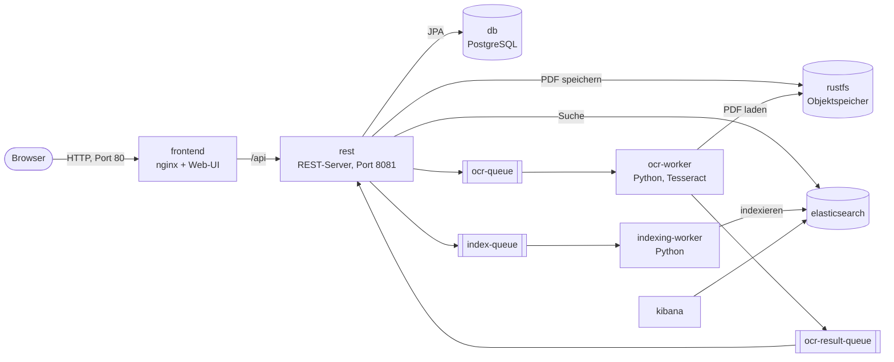

# Document Management System

Semesterprojekt für SWEN3: ein Dokumentenmanagementsystem zum Archivieren von Dokumenten,
mit OCR, KI-generierten Zusammenfassungen und Volltextsuche.

**Stand Sprint 4:** Upload von PDFs über die Web-UI oder die REST-API und Dokumentstatus mit Verlauf
(zusätzlicher Use Case). Die PDFs liegen in RustFS. Nach jedem Upload liest der OCR-Worker den Text aus
dem PDF (Tesseract), der REST-Server speichert ihn, und der Indexing-Worker schreibt ihn nach Elasticsearch.
Die Web-UI zeigt den erkannten Text an und sucht über den REST-Server im Volltext.

- Repository: https://github.com/PrawdaMax/DocumentManagementSystem
- Kanban-Board: https://github.com/users/PrawdaMax/projects/1

## Architektur



| Ordner                       | Inhalt                                                                         |
|------------------------------|--------------------------------------------------------------------------------|
| `paperless-rest/`            | REST-Server (Java 25, Spring Boot 4, JPA, MapStruct)                           |
| `paperless-frontend/`        | Web-UI (React, Vite, Tailwind), ausgeliefert über nginx                        |
| `paperless-ocr-worker/`      | OCR-Worker (Python 3.14, pika, minio, pdf2image/Poppler, pytesseract)          |
| `paperless-indexing-worker/` | Indexing-Worker (Python 3.14, pika, elasticsearch)                             |

Die beiden Worker teilen keinen Code mit dem REST-Server und auch nicht untereinander.

Der REST-Server hat sechs Schichten, jede ist ein Package: `presentation` (Controller, Listener, Fehlerbehandlung),
`business` (Services, DTOs, Mapper, Validierung, Exceptions), `persistence` (Entities, Repositories),
`messaging` (Nachrichten und Queues von RabbitMQ), `storage` (PDFs in RustFS, über die S3-API)
und `search` (Suche in Elasticsearch).

## Starten

```bash
docker compose up --build
```

Eine `.env` ist nicht nötig: Ohne sie gelten die Default-Zugangsdaten aus `docker-compose.yml`
(Benutzer `paperless`, Passwort `change-me`, nur für die lokale Entwicklung). Eigene Werte mit
`cp .env.example .env` anlegen und anpassen.

| Dienst              | Adresse                                | Login                                                 |
|---------------------|----------------------------------------|-------------------------------------------------------|
| Web-UI              | http://localhost                       | –                                                     |
| REST-API            | http://localhost:8081/api/documents    | –                                                     |
| RabbitMQ-Management | http://localhost:15672                 | `paperless` / `change-me` (oder Werte aus der `.env`) |
| RustFS-Konsole      | http://localhost:9090                  | `paperless` / `change-me` (oder Werte aus der `.env`) |
| Elasticsearch       | http://localhost:9200                  | – (Security ist für die Entwicklung abgeschaltet)     |
| Kibana              | http://localhost:5601                  | –                                                     |

Der REST-Server wartet beim Start auf PostgreSQL, RabbitMQ und RustFS, nicht auf Elasticsearch: Upload und
Anzeige funktionieren also schon, während Elasticsearch noch hochfährt. Elasticsearch braucht etwa 1 GB RAM
und kann eine Minute zum Starten brauchen.

PostgreSQL und RabbitMQ übernehmen die Zugangsdaten nur beim ersten Start. Wurden sie geändert,
die Volumes mit `docker compose down -v` löschen. RustFS liest sie bei jedem Start neu.

## Tests und CI

**Teststrategie:**

- **REST-Server:** Unit-Tests pro Schicht (JUnit 5, Mockito, MockMvc), die Mapper werden direkt getestet.
- **Worker:** Unit-Tests mit pytest. RabbitMQ, RustFS und Elasticsearch werden gemockt, getestet werden die
  Verarbeitung einer Nachricht, die gesendete Antwort und das Verwerfen fehlerhafter Nachrichten.
- **Echter OCR-Test** (`paperless-ocr-worker/tests/test_ocr.py`): erzeugt ein PDF mit bekanntem Text und lässt
  Poppler und Tesseract ohne Mocks darüber laufen. Lokal wird er übersprungen, wenn die Programme fehlen,
  in der CI läuft er immer.
- **Web-UI:** hat kaum eigene Logik und wird über Linter und Typprüfung abgesichert.

Gemockt wird nur an den Systemgrenzen, die Unit-Tests brauchen also keine laufenden Dienste. Das Zusammenspiel
aller Services prüfen wir von Hand, automatisierte Integrationstests folgen in Sprint 6.

**CI:** GitHub Actions (`.github/workflows/ci.yml`) führt bei jedem Push vier Jobs aus: REST-Server, OCR-Worker
(installiert dafür `tesseract-ocr`, `tesseract-ocr-deu` und `poppler-utils`), Indexing-Worker und Web-UI.

## REST-API

| Methode | Pfad                                   | Beschreibung                             | Antwort            |
|---------|----------------------------------------|------------------------------------------|--------------------|
| GET     | `/api/documents`                       | Alle Dokumente                           | 200                |
| GET     | `/api/documents/search?query={text}`   | Volltextsuche in Titel und OCR-Text, unscharf, beste Treffer zuerst | 200, 400, 503 |
| GET     | `/api/documents/{id}`                  | Ein Dokument                             | 200, 404           |
| GET     | `/api/documents/{id}/file`             | Das PDF, öffnet sich im Browser          | 200, 404, 503      |
| POST    | `/api/documents`                       | PDF hochladen (`file`, optional `title`) | 201, 400, 413, 503 |
| PUT     | `/api/documents/{id}`                  | Titel ändern                             | 200, 400, 404, 503 |
| DELETE  | `/api/documents/{id}`                  | Dokument samt Verlauf, PDF und Suchindex | 204, 404, 503      |
| PATCH   | `/api/documents/{id}/status`           | Status ändern                            | 200, 400, 404, 409 |
| GET     | `/api/documents/{id}/history`          | Statusverlauf, neuester Eintrag zuerst   | 200, 404           |

Ein Dokument enthält das Feld `content` mit dem OCR-Text. Es ist `null`, solange die OCR noch läuft.

Jeder Statuswechsel wird mit Zeitpunkt und optionalem Kommentar im Verlauf gespeichert.
Nicht erlaubte Wechsel lehnt der Server mit `409` ab:

| Status                       | Erlaubte Wechsel        |
|------------------------------|-------------------------|
| `RECEIVED` (nach dem Upload) | `IN_REVIEW`, `REJECTED` |
| `IN_REVIEW`                  | `DONE`, `REJECTED`      |
| `REJECTED`                   | `IN_REVIEW`             |
| `DONE`                       | `ARCHIVED`              |
| `ARCHIVED`                   | – (Endzustand)          |

## Nachrichten (RabbitMQ)

REST-Server und Worker teilen keinen Code. Der Vertrag zwischen ihnen sind diese JSON-Nachrichten in durable
Queues. Die PDFs liegen in RustFS im Bucket `documents`.

| Queue              | Von → An                 | Nachricht                                                                                     |
|--------------------|--------------------------|-----------------------------------------------------------------------------------------------|
| `ocr-queue`        | REST → OCR-Worker        | `{"documentId": 1, "fileName": "rechnung.pdf", "objectKey": "3f2c9a1e-….pdf"}`                 |
| `ocr-result-queue` | OCR-Worker → REST        | `{"documentId": 1, "content": "Erkannter Text ..."}`                                          |
| `index-queue`      | REST → Indexing-Worker   | `{"documentId": 1, "title": "Rechnung", "content": "Erkannter Text ..."}`                     |

Ablauf beim Upload:

1. Der REST-Server prüft die Datei (Endung `.pdf` und Magic Bytes `%PDF-`) und legt das PDF unter
   `<UUID>.pdf` in RustFS ab. Ist RustFS nicht erreichbar, entsteht nichts, und der Client bekommt `503`.
2. Danach speichert er das Dokument mit Status `RECEIVED` und schickt in derselben Transaktion den Auftrag in die
   `ocr-queue`. Ist RabbitMQ nicht erreichbar, wird das Speichern zurückgerollt, das PDF wieder gelöscht, und der
   Client bekommt `503`.
3. Der OCR-Worker lädt das PDF aus RustFS, wandelt jede Seite mit Poppler in ein Bild (300 dpi) und liest den
   Text mit Tesseract (Deutsch und Englisch). Das Ergebnis schickt er in die `ocr-result-queue`.
4. Der REST-Server speichert den Text im Feld `content`, schreibt „OCR completed“ in den Verlauf und schickt das
   Dokument in die `index-queue`. Nach einer Titeländerung schickt er es erneut.
5. Der Indexing-Worker schreibt es in den Elasticsearch-Index `documents`, die Dokument-ID ist auch die
   Elasticsearch-ID.
6. Die Suche der Web-UI fragt den REST-Server. Er holt die passenden IDs aus Elasticsearch und die Dokumente
   aus PostgreSQL.

Beide Worker bestätigen eine verarbeitete Nachricht mit `ack`. Schlägt die Verarbeitung fehl (ungültiges JSON,
fehlendes Feld, PDF nicht in RustFS, Elasticsearch-Fehler), loggen sie den Fehler als ERROR und verwerfen die
Nachricht (`nack` ohne Requeue). Verlieren sie die Verbindung zu RabbitMQ, startet Docker sie neu.

## Validierung, Fehlerbehandlung und Logging

Eingaben werden mehrfach geprüft: im Formular der Web-UI, im Controller (Bean Validation) und im Service
(PDF-Prüfung, Länge von Titel, Dateiname und Suchanfrage, erlaubte Statuswechsel). Jede Schicht hat eigene Exceptions, nur der `GlobalExceptionHandler`
übersetzt sie in HTTP-Antworten:

| Schicht      | Exception                                                                               | Antwort       |
|--------------|-----------------------------------------------------------------------------------------|---------------|
| Persistence  | `DataAccessException` (von Spring)                                                      | 500           |
| Business     | `ResourceNotFoundException`, `InvalidDocumentException`, `InvalidSearchQueryException`, `InvalidStatusChangeException` | 404, 400, 400, 409 |
| Messaging    | `MessagePublishException` (RabbitMQ nicht erreichbar)                                   | 503           |
| Storage      | `StorageException` (RustFS nicht erreichbar)                                            | 503           |
| Search       | `SearchException` (Elasticsearch nicht erreichbar)                                      | 503           |
| Presentation | Fallback für alles Unerwartete                                                          | 500           |

Geloggt wird auf `INFO` für Abläufe (Upload, Statuswechsel, gesendete und empfangene Nachrichten), auf `WARN`
für Client-Fehler wie 400, 404 und 409 und auf `ERROR` mit Stacktrace für Server-Fehler.
Die Logs zeigt `docker compose logs rest`, `docker compose logs ocr-worker` bzw. `docker compose logs indexing-worker`.

## Design-Entscheidungen

- **Interfaces an den Systemgrenzen** (`DocumentRepository`, `MessagePublisher`, `FileStorage`, `SearchIndex`):
  Der Service kennt nur die Interfaces und lässt sich mit Mocks testen. Die Worker bekommen den Speicher- bzw. Elasticsearch-Client
  im Konstruktor übergeben, damit die Tests ihn ersetzen können.
- **MapStruct statt handgeschriebener Mapper:** Die Mapper sind nur noch Interfaces, MapStruct erzeugt den Code
  beim Kompilieren. Vergessene Felder fallen dadurch als Warnung im Build auf.
- **Listener in `presentation`:** Controller und `OcrResultListener` sind beide Eingänge von außen und rufen nur
  den Service auf. Läge der Listener in `messaging`, gäbe es einen Paketzyklus `business` ↔ `messaging`.
- **`MultipartFile` bleibt im Controller:** Die Business-Schicht bekommt ein `DocumentUploadDto` und bleibt
  unabhängig von HTTP.
- **Senden in der Transaktion:** Es gibt kein gespeichertes Dokument ohne OCR-Auftrag.
- **RustFS statt MinIO:** Die Aufgabe nennt MinIO, das offizielle Image `minio/minio` gibt es auf Docker Hub aber
  nicht mehr, und das GitHub-Repo von MinIO ist archiviert. Der Lektor hat RustFS vorgeschlagen. Es hat dieselbe
  S3-API und läuft wie in der Vorgabe auf Port 9000 (API) und 9090 (Web-Konsole). Der Code spricht nur S3 über das
  MinIO-SDK, ein anderer S3-Speicher ändert also nur `docker-compose.yml`.
- **Poppler statt Ghostscript:** Tesseract liest nur Bilder, keine PDFs. Die Aufgabe nennt dafür Ghostscript
  „or the like“. Wir nehmen Poppler (`pdftoppm`), das genauso jede PDF-Seite in ein Bild umwandelt. Die
  Python-Bibliothek `pdf2image` braucht dafür nur einen Aufruf (`convert_from_bytes`), danach liest Tesseract
  den Text auf Deutsch und Englisch.
- **ELK ohne Logstash:** Elasticsearch speichert und durchsucht die Texte, Kibana (http://localhost:5601) ist die
  Web-Oberfläche dazu, z. B. für `GET documents/_search?q=Hello` in den Dev Tools. Logstash ist eine Pipeline,
  die Daten (meist Logs) einsammelt, umformt und an Elasticsearch weitergibt. Keine Aufgabe braucht das, der
  Indexing-Worker schreibt direkt in Elasticsearch. Logstash würde etwa 1 GB RAM und eine eigene
  Pipeline-Konfiguration kosten, ohne etwas beizutragen.
- **PDFs in RustFS, nicht in der Nachricht:** Die Nachricht enthält nur den `objectKey`, so bleiben die
  Nachrichten klein, und auch große PDFs passen durch RabbitMQ. RustFS ist S3-kompatibel, deshalb reicht im
  REST-Server und im Worker der MinIO-Client. Schlägt nach dem Speichern des PDFs etwas fehl, löscht der
  REST-Server es wieder (Kompensation).
- **Worker in Python:** Die Worker sollen unabhängig voneinander laufen. Python hat gute Bibliotheken für
  Tesseract, Elasticsearch und Gemini.
- **Der REST-Server verteilt die Aufträge:** Die Worker kennen nur ihre Queues, nicht einander. Fällt einer aus,
  warten seine Aufträge in der Queue. Der REST-Server bleibt die einzige Stelle, die in die Datenbank schreibt.
- **Eigener Indexing-Worker:** Das Indexieren ist vom OCR getrennt. So kann man den Index neu aufbauen oder
  Elasticsearch austauschen, ohne die OCR anzufassen.
- **Dokument-ID als Elasticsearch-ID:** Wird ein Dokument erneut indexiert, überschreibt es den alten Eintrag,
  statt einen zweiten anzulegen.
- **Suche über den REST-Server:** Die Web-UI spricht nie direkt mit Elasticsearch. Elasticsearch bleibt intern,
  und die Suche ist Teil der REST-API, als eigener `DocumentSearchService` neben dem `DocumentService`.
  Elasticsearch liefert nur die IDs in der Reihenfolge der Relevanz, die Daten kommen aus PostgreSQL. Gelöschte
  Dokumente fallen so heraus, auch wenn sie noch im Index stehen.

## Bekannte Grenzen

- **Verlorene Aufträge bei Ausfällen:** Ist RustFS oder Elasticsearch gerade nicht erreichbar, verwirft der
  Worker die Nachricht. Es gibt noch keine Dead-Letter-Queue und keine Wiederholung, das Dokument bleibt dann
  ohne Text bzw. ohne Suchindex. Eine Titeländerung indexiert es erneut.
- **Lange OCR blockiert den Worker:** Der OCR-Worker bearbeitet einen Auftrag nach dem anderen (`prefetch_count=1`).
  Der RabbitMQ-Heartbeat ist auf 10 Minuten gestellt, damit große PDFs die Verbindung nicht abreißen lassen.
- **OCR-Qualität:** Tesseract liest gedruckten Text in Deutsch und Englisch gut, Handschrift, schiefe Scans und
  Tabellen schlecht. Eingebetteter Text in digitalen PDFs wird nicht direkt übernommen, sondern auch per OCR gelesen.
- **Keine Sicherheit in der Entwicklungsumgebung:** Elasticsearch und Kibana laufen ohne Login, die Zugangsdaten
  stehen als Defaults im Klartext in `docker-compose.yml` (bzw. in der `.env`).
- **Suche erst nach dem Indexieren:** Ein frisch hochgeladenes Dokument wird erst gefunden, wenn OCR und
  Indexierung fertig sind.

## Lessons Learned

- Schnittstellen vorher gemeinsam festlegen
- Merges prüfen: Ein Konflikt hat alte README-Abschnitte zurückgebracht
- Pull Requests und CI früh nutzen, statt lokal zu mergen.
