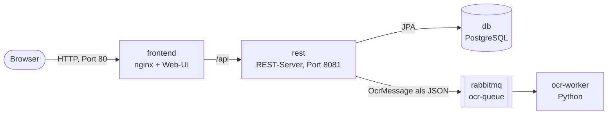

# Document Management System

Semesterprojekt für SWEN3: ein Dokumentenmanagementsystem zum Archivieren von Dokumenten,
mit OCR, KI-generierten Zusammenfassungen und Volltextsuche.

**Stand Sprint 3:** Upload von PDFs über die Web-UI oder die REST-API und Dokumentstatus mit Verlauf
(zusätzlicher Use Case). Nach jedem Upload schickt der REST-Server über RabbitMQ einen Auftrag an den
OCR-Worker, der ihn entgegennimmt und loggt. Die eigentliche OCR folgt in Sprint 4.

- Repository: https://github.com/PrawdaMax/DocumentManagementSystem
- Kanban-Board: https://github.com/users/PrawdaMax/projects/1

## Architektur



| Ordner                  | Inhalt                                                                    |
|-------------------------|---------------------------------------------------------------------------|
| `paperless-rest/`       | REST-Server (Java 25, Spring Boot 4, JPA)                                 |
| `paperless-frontend/`   | Web-UI (React, Vite, Tailwind), ausgeliefert über nginx                   |
| `paperless-ocr-worker/` | OCR-Worker (Python 3.14, pika), ohne gemeinsamen Code mit dem REST-Server |

Der REST-Server hat vier Schichten, jede ist ein Package: `presentation` (Controller, Fehlerbehandlung),
`business` (Service, DTOs, Mapper, Validierung, Exceptions), `persistence` (Entities, Repositories)
und `messaging` (Versand der OCR-Aufträge an RabbitMQ).

## Starten

```bash
cp .env.example .env        # Zugangsdaten für PostgreSQL und RabbitMQ
docker compose up --build
```

- Web-UI: http://localhost
- REST-API: http://localhost:8081/api/documents
- RabbitMQ-Management: http://localhost:15672 (Login mit den Werten aus der `.env`)

PostgreSQL und RabbitMQ übernehmen die Zugangsdaten nur beim ersten Start. Wurden sie geändert,
die Volumes mit `docker compose down -v` löschen.

## Tests und CI

**Teststrategie:** Unit-Tests pro Schicht im REST-Server (JUnit 5, Mockito, MockMvc) und für den Worker (pytest).
Gemockt wird nur an den Systemgrenzen (Datenbank, RabbitMQ), die Tests brauchen also keine laufenden Dienste.
Die Web-UI hat kaum eigene Logik und wird über Linter und Typprüfung abgesichert. Das Zusammenspiel aller
Services prüfen wir von Hand, automatisierte Integrationstests folgen in Sprint 6.

**CI:** GitHub Actions (`.github/workflows/ci.yml`) führt diese drei Prüfungen bei jedem Push aus.

## REST-API

| Methode | Pfad                          | Beschreibung                             | Antwort            |
|---------|-------------------------------|------------------------------------------|--------------------|
| GET     | `/api/documents`              | Alle Dokumente                           | 200                |
| GET     | `/api/documents/{id}`         | Ein Dokument                             | 200, 404           |
| POST    | `/api/documents`              | PDF hochladen (`file`, optional `title`) | 201, 400, 413, 503 |
| PUT     | `/api/documents/{id}`         | Titel ändern                             | 200, 400, 404      |
| DELETE  | `/api/documents/{id}`         | Dokument samt Verlauf löschen            | 204, 404           |
| PATCH   | `/api/documents/{id}/status`  | Status ändern                            | 200, 400, 404, 409 |
| GET     | `/api/documents/{id}/history` | Statusverlauf, neuester Eintrag zuerst   | 200, 404           |

Jeder Statuswechsel wird mit Zeitpunkt und optionalem Kommentar im Verlauf gespeichert.
Nicht erlaubte Wechsel lehnt der Server mit `409` ab:

| Status                       | Erlaubte Wechsel        |
|------------------------------|-------------------------|
| `RECEIVED` (nach dem Upload) | `IN_REVIEW`, `REJECTED` |
| `IN_REVIEW`                  | `DONE`, `REJECTED`      |
| `REJECTED`                   | `IN_REVIEW`             |
| `DONE`                       | `ARCHIVED`              |
| `ARCHIVED`                   | – (Endzustand)          |

## Nachrichten (RabbitMQ)

REST-Server und OCR-Worker teilen keinen Code. Der Vertrag zwischen beiden ist diese JSON-Nachricht
in der durable Queue `ocr-queue` (der Worker liest `documentId` und `fileName`):

```json
{"documentId": 1, "title": "Rechnung", "fileName": "rechnung.pdf"}
```

Ablauf beim Upload:

1. Der REST-Server prüft die Datei (Endung `.pdf` und Magic Bytes `%PDF-`) und speichert das Dokument
   mit Status `RECEIVED`.
2. In derselben Transaktion schickt er die Nachricht. Ist RabbitMQ nicht erreichbar, wird das Speichern
   zurückgerollt, und der Client bekommt `503`.
3. Der OCR-Worker loggt den Auftrag und bestätigt ihn (`ack`). Eine fehlerhafte Nachricht loggt er als
   ERROR und verwirft sie (`nack` ohne Requeue). Verliert er die Verbindung, startet Docker ihn neu.

## Validierung, Fehlerbehandlung und Logging

Eingaben werden mehrfach geprüft: im Formular der Web-UI, im Controller (Bean Validation) und im Service
(PDF-Prüfung, erlaubte Statuswechsel). Jede Schicht hat eigene Exceptions, nur der `GlobalExceptionHandler`
übersetzt sie in HTTP-Antworten:

| Schicht      | Exception                                                                               | Antwort       |
|--------------|-----------------------------------------------------------------------------------------|---------------|
| Persistence  | `DataAccessException` (von Spring)                                                      | 500           |
| Business     | `ResourceNotFoundException`, `InvalidDocumentException`, `InvalidStatusChangeException` | 404, 400, 409 |
| Messaging    | `MessagePublishException` (RabbitMQ nicht erreichbar)                                   | 503           |
| Presentation | Fallback für alles Unerwartete                                                          | 500           |

Geloggt wird auf `INFO` für Abläufe (Upload, Statuswechsel, gesendete und empfangene Aufträge), auf `WARN`
für Client-Fehler wie 400, 404 und 409 und auf `ERROR` mit Stacktrace für Server-Fehler.
Die Logs zeigt `docker compose logs rest` bzw. `docker compose logs ocr-worker`.

## Design-Entscheidungen

- **Interfaces an den Systemgrenzen** (`DocumentRepository`, `OcrMessagePublisher`): Der Service kennt nur
  die Interfaces und lässt sich mit Mocks testen.
- **`MultipartFile` bleibt im Controller:** Die Business-Schicht bekommt ein `DocumentUploadDto` und bleibt
  unabhängig von HTTP.
- **Senden in der Transaktion:** Es gibt kein gespeichertes Dokument ohne OCR-Auftrag.
- **OCR-Worker in Python:** Die Worker sollen unabhängig voneinander laufen.
  Python hat gute Bibliotheken für Tesseract und Gemini.
- **Der REST-Server verteilt die Aufträge:** Die Worker kennen nur ihre Queue, nicht einander. Fällt einer aus,
  warten seine Aufträge in der Queue.

## Lessons Learned

- Schnittstellen vorher gemeinsam festlegen
- Merges prüfen: Ein Konflikt hat alte README-Abschnitte zurückgebracht
- Pull Requests und CI früh nutzen, statt lokal zu mergen.
