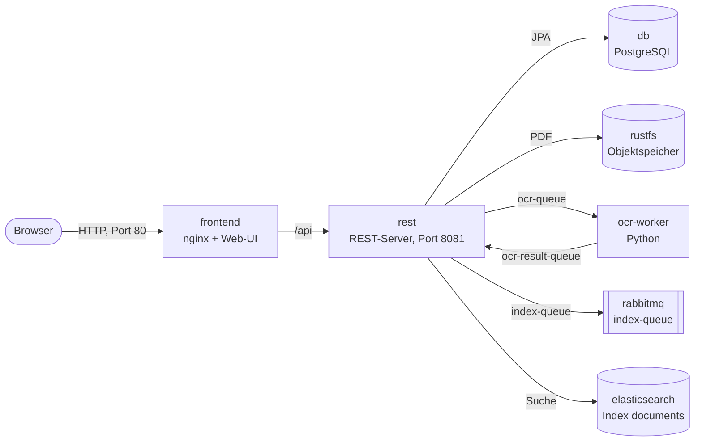

# Document Management System

Semesterprojekt für SWEN3: ein Dokumentenmanagementsystem zum Archivieren von Dokumenten,
mit OCR, KI-generierten Zusammenfassungen und Volltextsuche.

**Stand Sprint 3:** Upload von PDFs über die Web-UI oder die REST-API und Dokumentstatus mit Verlauf
(zusätzlicher Use Case). Nach jedem Upload schickt der REST-Server über RabbitMQ einen Auftrag an den
OCR-Worker, der ihn entgegennimmt und loggt. Die eigentliche OCR folgt in Sprint 4.

- Repository: https://github.com/PrawdaMax/DocumentManagementSystem
- Kanban-Board: https://github.com/users/PrawdaMax/projects/1

## Architektur



| Ordner                  | Inhalt                                                                    |
|-------------------------|---------------------------------------------------------------------------|
| `paperless-rest/`       | REST-Server (Java 25, Spring Boot 4, JPA)                                 |
| `paperless-frontend/`   | Web-UI (React, Vite, Tailwind), ausgeliefert über nginx                   |
| `paperless-ocr-worker/` | OCR-Worker (Python 3.14, pika), ohne gemeinsamen Code mit dem REST-Server |

Der REST-Server hat sechs Schichten, jede ist ein Package: `presentation` (Controller, Listener, Fehlerbehandlung),
`business` (Services, DTOs, Mapper, Validierung, Exceptions), `persistence` (Entities, Repositories),
`messaging` (Nachrichten und Queues von RabbitMQ), `storage` (PDFs in RustFS, über die S3-API)
und `search` (Suche in Elasticsearch).

## Starten

```bash
docker compose up --build
```

Eine `.env` ist nicht nötig: Ohne sie gelten die Default-Zugangsdaten aus `docker-compose.yml`
(Benutzer `paperless`, Passwort `change-me`, nur für die lokale Entwicklung). Eigene Werte mit
`cp .env.example .env` anlegen und anpassen.

- Web-UI: http://localhost
- REST-API: http://localhost:8081/api/documents
- RabbitMQ-Management: http://localhost:15672
- RustFS-Konsole (Bucket `documents` mit den PDFs): http://localhost:9001

PostgreSQL und RabbitMQ übernehmen die Zugangsdaten nur beim ersten Start. Wurden sie geändert,
die Volumes mit `docker compose down -v` löschen.

## Tests und CI

**Teststrategie:** Unit-Tests pro Schicht im REST-Server (JUnit 5, Mockito, MockMvc) und für den Worker (pytest).
Gemockt wird nur an den Systemgrenzen (Datenbank, RabbitMQ, RustFS, Elasticsearch), die Tests brauchen also keine
laufenden Dienste.
Die Web-UI hat kaum eigene Logik und wird über Linter und Typprüfung abgesichert. Das Zusammenspiel aller
Services prüfen wir von Hand, automatisierte Integrationstests folgen in Sprint 6.

**CI:** GitHub Actions (`.github/workflows/ci.yml`) führt diese drei Prüfungen bei jedem Push aus.

## REST-API

| Methode | Pfad                          | Beschreibung                             | Antwort            |
|---------|-------------------------------|------------------------------------------|--------------------|
| GET     | `/api/documents`              | Alle Dokumente                           | 200                |
| GET     | `/api/documents/search?query=` | Volltextsuche in Titel und Text, unscharf, beste Treffer zuerst | 200, 400, 503 |
| GET     | `/api/documents/{id}`         | Ein Dokument, OCR-Text in `content`      | 200, 404           |
| POST    | `/api/documents`              | PDF hochladen (`file`, optional `title`) | 201, 400, 413, 503 |
| PUT     | `/api/documents/{id}`         | Titel ändern                             | 200, 400, 404      |
| DELETE  | `/api/documents/{id}`         | Dokument samt Verlauf, PDF und Suchindex | 204, 404, 503      |
| PATCH   | `/api/documents/{id}/status`  | Status ändern                            | 200, 400, 404, 409 |
| GET     | `/api/documents/{id}/history` | Statusverlauf, neuester Eintrag zuerst   | 200, 404           |

Jeder Statuswechsel wird mit Zeitpunkt und optionalem Kommentar im Verlauf gespeichert.
Nicht erlaubte Wechsel lehnt der Server mit `409` ab:

| Status                       | Erlaubte Wechsel        |
|------------------------------|-------------------------|
| `RECEIVED` (nach dem Upload) | `IN_REVIEW`, `REJECTED` |
| `IN_REVIEW`                  | `DONE`, `REJECTED`      |
| `REJECTED`                   | `IN_REVIEW`             |
| `DONE`                       | `ARCHIVED`              |
| `ARCHIVED`                   | – (Endzustand)          |

## Nachrichten (RabbitMQ)

REST-Server und Worker teilen keinen Code. Der Vertrag zwischen ihnen sind diese JSON-Nachrichten in durable
Queues. Die PDF liegt in RustFS (Bucket `documents`), der OCR-Auftrag enthält nur ihren Schlüssel `objectKey`.

| Queue              | Von → An               | Nachricht                                                                   |
|--------------------|------------------------|-----------------------------------------------------------------------------|
| `ocr-queue`        | REST → OCR-Worker      | `{"documentId": 1, "fileName": "rechnung.pdf", "objectKey": "3f2c….pdf"}`   |
| `ocr-result-queue` | OCR-Worker → REST      | `{"documentId": 1, "content": "Hello World"}`                               |
| `index-queue`      | REST → Indexing-Worker | `{"documentId": 1, "title": "Rechnung", "content": "Hello World"}`          |

Ablauf beim Upload:

1. Der REST-Server prüft die Datei (Endung `.pdf` und Magic Bytes `%PDF-`) und speichert die PDF unter
   `<UUID>.pdf` in RustFS. Ist RustFS nicht erreichbar, entsteht nichts, und der Client bekommt `503`.
2. Danach speichert er das Dokument mit Status `RECEIVED` und schickt in derselben Transaktion die Nachricht.
   Ist RabbitMQ nicht erreichbar, wird das Speichern zurückgerollt, die PDF wieder gelöscht, und der Client
   bekommt `503`.
3. Der OCR-Worker erkennt den Text und schickt ihn an `ocr-result-queue`. Eine fehlerhafte Nachricht loggt er
   als ERROR und verwirft sie (`nack` ohne Requeue). Verliert er die Verbindung, startet Docker ihn neu.
4. Der REST-Server speichert den Text im Feld `content`, schreibt „OCR completed“ in den Verlauf und schickt
   Titel und Text an `index-queue`. Ändert sich später der Titel, schickt er den Index-Auftrag erneut.
   Wurde das Dokument inzwischen gelöscht, ignoriert er das Ergebnis (WARN im Log). Eine Nachricht, die er nicht
   verarbeiten kann, verwirft er, statt sie endlos neu zuzustellen (`default-requeue-rejected=false`).

## Validierung, Fehlerbehandlung und Logging

Eingaben werden mehrfach geprüft: im Formular der Web-UI, im Controller (Bean Validation) und im Service
(PDF-Prüfung, erlaubte Statuswechsel). Jede Schicht hat eigene Exceptions, nur der `GlobalExceptionHandler`
übersetzt sie in HTTP-Antworten:

| Schicht      | Exception                                                                               | Antwort       |
|--------------|-----------------------------------------------------------------------------------------|---------------|
| Persistence  | `DataAccessException` (von Spring)                                                      | 500           |
| Business     | `ResourceNotFoundException`, `InvalidDocumentException`, `InvalidSearchQueryException`, `InvalidStatusChangeException` | 404, 400, 400, 409 |
| Messaging    | `MessagePublishException` (RabbitMQ nicht erreichbar)                                   | 503           |
| Storage      | `StorageException` (RustFS nicht erreichbar)                                            | 503           |
| Search       | `SearchException` (Elasticsearch nicht erreichbar)                                      | 503           |
| Presentation | Fallback für alles Unerwartete                                                          | 500           |

Geloggt wird auf `INFO` für Abläufe (Upload, Statuswechsel, gesendete und empfangene Aufträge), auf `WARN`
für Client-Fehler wie 400, 404 und 409 und auf `ERROR` mit Stacktrace für Server-Fehler.
Die Logs zeigt `docker compose logs rest` bzw. `docker compose logs ocr-worker`.

## Design-Entscheidungen

- **Interfaces an den Systemgrenzen** (`DocumentRepository`, `MessagePublisher`, `FileStorage`, `SearchIndex`): Der Service
  kennt nur die Interfaces und lässt sich mit Mocks testen. Ein anderer S3-Speicher ändert nur `docker-compose.yml`.
- **Suche als eigener Service** (`DocumentSearchService`): `DocumentService` bleibt für das Verwalten zuständig.
  Elasticsearch liefert nur die IDs in der Reihenfolge der Relevanz, die Daten kommen aus PostgreSQL. Gelöschte
  Dokumente fallen so heraus, auch wenn sie noch im Index stehen. Der REST-Server wartet beim Start nicht auf
  Elasticsearch: Ist es nicht erreichbar, antwortet nur die Suche mit `503`.
- **PDF in RustFS, nur der Schlüssel in der Nachricht** (Claim-Check): Die Nachrichten bleiben klein. Schlägt
  nach dem Speichern der PDF etwas fehl, löscht der REST-Server sie wieder (Kompensation).
- **Listener in `presentation`:** Controller und `OcrResultListener` sind beide Eingänge von außen und rufen nur
  den Service auf. Läge der Listener in `messaging`, gäbe es einen Paketzyklus `business` ↔ `messaging`.
- **`MultipartFile` bleibt im Controller:** Die Business-Schicht bekommt ein `DocumentUploadDto` und bleibt
  unabhängig von HTTP.
- **Senden in der Transaktion:** Es gibt kein gespeichertes Dokument ohne OCR-Auftrag.
- **OCR-Worker in Python:** Die Worker sollen unabhängig voneinander laufen.
  Python hat gute Bibliotheken für Tesseract und Gemini.
- **Der REST-Server verteilt die Aufträge:** Die Worker kennen nur ihre Queue, nicht einander. Fällt einer aus,
  warten seine Aufträge in der Queue.

## Lessons Learned

- Schnittstellen vorher gemeinsam festlegen
- Merges prüfen: Ein Konflikt hat alte README-Abschnitte zurückgebracht
- Pull Requests und CI früh nutzen, statt lokal zu mergen.
